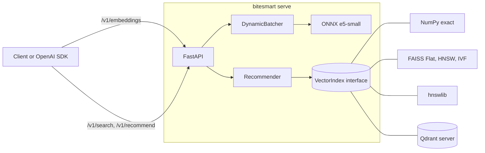

# BiteSmart RecSys

An OpenAI-compatible `/v1/embeddings` server with dynamic batching, a benchmark that compares
vector indexes (NumPy exact, FAISS Flat/HNSW/IVF, hnswlib, Qdrant) on recall@10 versus latency
and memory with metadata filters, and a product substitution recommender built on top of it.

The model is `intfloat/multilingual-e5-small` (384 dimensions). No model is trained here.

## The task

Given a grocery product the user wants to replace, return safe and sensible substitutes that
respect allergens, diets and nutrient limits. This needs three things that this project builds
and measures.

1. A fast embedding service that other tools can call with the standard OpenAI client.
2. A vector index that supports metadata filters, chosen with evidence instead of guesswork.
3. A recommender that treats allergens and diets as hard constraints, never as soft scores.

## Run the demo with one command

Requirements are Docker with Compose v2 and at least 2.5 GB of RAM available to Docker. The demo
was verified with exactly that on a 3.4 GB laptop, and the first start takes several minutes.

```bash
docker compose --profile demo up --build --abort-on-container-exit --exit-code-from demo
```

This starts Qdrant and the API, waits until the model is loaded, and then runs a scripted tour.

1. Calls `/v1/embeddings` and prints cosine similarities.
2. Sends 48 concurrent single-text requests and prints the batching statistics.
3. Runs a filtered semantic search (vegan, no milk allergen).
4. Builds a substitution recommendation with hard constraints and prints the reasons.
5. Benchmarks the indexes on 5000 vectors, including the Qdrant server.

The first start downloads the model (about 470 MB) into a Docker volume. Later starts reuse it.
To keep the server running and call it yourself, use `docker compose up -d --build`, then

```bash
curl http://localhost:8000/v1/embeddings -H "Content-Type: application/json" \
  -d '{"model":"intfloat/multilingual-e5-small","input":["greek yogurt","шоколадный батончик"]}'
```

Or with the official SDK, unchanged.

```python
from openai import OpenAI

client = OpenAI(base_url="http://localhost:8000/v1", api_key="unused")
result = client.embeddings.create(model="intfloat/multilingual-e5-small", input="oat drink")
print(len(result.data[0].embedding))  # 384
```

## Local development

```bash
uv sync --extra report          # add --extra ann for hnswlib (needs a C++ compiler)
uv run pre-commit install
make check                      # ruff, mypy strict, pytest with coverage gate 70%
uv run bitesmart --help
```

| Command | What it does |
|---|---|
| `bitesmart serve --catalog data/catalog.jsonl --index faiss_hnsw` | Run the API |
| `bitesmart embed "text 1" "text 2"` | Embed locally and print the cosine matrix |
| `bitesmart bench --n 20000 --plots` | Index benchmark, writes CSV, JSON, Markdown, PNG |
| `bitesmart bench-embed` | Throughput with and without dynamic batching |
| `bitesmart recommend <product id> --vegan --forbid-allergen en:milk` | Substitutes in process |
| `bitesmart generate-catalog --n 2000` | Seeded synthetic Open Food Facts style catalog |

Settings come from `BITESMART_*` environment variables, see `src/bitesmart_recsys/settings.py`.
Use `BITESMART_EMBEDDER_BACKEND=hash` for an offline deterministic embedder (used by tests and CI).

## Architecture



More diagrams and the full reasoning are in [docs/architecture.md](docs/architecture.md).
The main decisions are summarised here.

| Decision | Why |
|---|---|
| ONNX Runtime instead of PyTorch | Smaller image, faster start. Pooling and normalisation are 10 lines with a test. |
| Dynamic batching with one asyncio worker | Many clients send one text. Merging them gives the model bigger batches. A bounded queue answers 429. |
| One `VectorIndex` interface and a neutral filter | Every backend is tested against the same reference and exact search. |
| Constraints are filters and are verified again | An approximate index must never leak an allergen. A test with a filter-ignoring index proves it. |
| Exact NumPy search as ground truth | recall@10 is computed against the exact result for the same filter. |
| Memory measured in a fresh process | In-process RSS is noisy. Qdrant is measured from its own metrics. |
| JSON logs, no `print` | Ruff rule `T20` enforces it. |

## Results

### Dynamic batching (real model, int8 variant, 32 concurrent clients, 192 requests)

| max batch | max wait ms | requests per s | p50 ms | p95 ms | mean batch |
|---|---|---|---|---|---|
| 1 (no batching) | 0 | 32.2 | 901 | 1627 | 1.0 |
| 8 | 5 | 64.1 | 470 | 558 | 8.0 |
| 32 | 10 | 87.3 | 381 | 428 | 32.0 |

Batching gives 2.7 times the throughput and less than half the p50 latency under load.
The numbers were measured on a small 3.4 GB laptop, so absolute values will differ elsewhere.

### Index comparison (20 000 vectors, 384 d, 200 queries, single thread)

Full tables for five filters are in
[docs/benchmarks/index_benchmark_n20000.md](docs/benchmarks/index_benchmark_n20000.md).
A short extract follows.

| Index | Params | recall@10 no filter | recall@10 vegan + Finland (25%) | recall@10 rare filter (1.5%) | p50 ms (no filter) | Index MB |
|---|---|---|---|---|---|---|
| NumPy exact | | 1.000 | 1.000 | 1.000 | 153 | 29 |
| FAISS Flat | | 1.000 | 1.000 | 1.000 | 7 | 29 |
| FAISS HNSW | ef 16 | 0.820 | 0.588 | 0.256 | 0.44 | 34 |
| FAISS HNSW | ef 64 | 0.987 | 0.743 | 0.380 | 0.61 | 34 |
| FAISS HNSW | ef 256 | 1.000 | 0.771 | 0.442 | 1.58 | 34 |
| FAISS IVF | nprobe 8 | 0.716 | 0.502 | 0.211 | 0.25 | 30 |
| FAISS IVF | nprobe 32 | 0.999 | 0.763 | 0.419 | 0.36 | 30 |

### Index comparison in Docker, with hnswlib and the Qdrant server (5000 vectors)

This run comes from the compose demo, so it includes Qdrant as a real server. Qdrant latency
includes the HTTP round trip. Full tables are in
[docs/benchmarks/index_benchmark_n5000_docker_qdrant.md](docs/benchmarks/index_benchmark_n5000_docker_qdrant.md).

| Index | Params | recall@10 no filter | recall@10 vegan + Finland (25%) | recall@10 rare filter (1.2%) | p50 ms (rare filter) |
|---|---|---|---|---|---|
| FAISS Flat | | 1.000 | 1.000 | 1.000 | 0.13 |
| FAISS HNSW | ef 64 | 1.000 | 0.861 | 0.406 | 0.32 |
| hnswlib | ef 16 | 0.928 | 0.975 | 0.990 | 4.56 |
| hnswlib | ef 64 | 0.999 | 0.996 | 1.000 | 7.97 |
| Qdrant server | ef 64 | 1.000 | 1.000 | 1.000 | 6.06 |

What this shows.

- Without a filter HNSW is the clear winner, with recall 0.987 at 0.6 ms against 153 ms for exact
  NumPy (20 000 vectors).
- Filters that correlate with the category (vegan, allergens) hurt FAISS HNSW and IVF, which apply
  the filter as an id selector during the graph walk. At the same effort HNSW drops to 0.77 at
  20 000 vectors, and to about 0.4 for a rare filter.
- hnswlib and the Qdrant server keep recall near 1.0 under every filter. Qdrant does it with payload
  indexes and a query planner that estimates how many points pass the filter. hnswlib does it
  by continuing the graph walk until enough matching points are found, which costs latency
  (a Python callback runs for every visited point).
- When a filter keeps few points, exact filtered search is perfect and very fast (0.13 ms for the
  1.2% filter), because it only scores the points that pass. This is why a planner that
  falls back to exact search for selective filters is the right design for this workload.
- Qdrant's per-query latency is mostly the network and serialisation cost, so for in-process
  use FAISS or hnswlib are faster, and Qdrant wins on filter correctness, persistence and scaling.
- The Qdrant memory figure (192 MB) is the server's resident growth including its own segment
  overhead. It is not comparable with the in-process index sizes.
- Reproduce with `uv run bitesmart bench --n 20000 --plots` for the in-process indexes. For Qdrant
  run `docker compose up -d qdrant` and pass `--qdrant-url http://localhost:6333`.
  hnswlib needs the `ann` extra, which compiles a C++ extension.

## The recommender

Ported from the BiteSmart Product Substitution Recommender (thesis project). The pipeline is

1. Build an index filter from the user constraints (allergens, traces, vegan and other diets,
   same root category, country, absolute and source-relative nutrient limits).
2. Search the index with the source product vector and that filter.
3. Verify every candidate against the constraints again.
4. Score by similarity plus brand and category diversity, with an incremental diversity bonus.
5. Rerank with the category transition penalty and per-brand and per-category penalties.
6. Attach explanations and return the top N.

Not ported are the MongoDB ingestion and the CatBoost reranker, because they need the full Open
Food Facts dump and trained artifacts. The synthetic catalog has the same schema.

## Evaluation protocol and roadmap (real Open Food Facts data)

The results above use a synthetic catalog. The next step is to repeat them on real Open Food Facts
products. This section is the protocol and the list of results still to be produced. Items marked
"to do" have no numbers yet, and no result in this section should be read as measured until its
status changes.

### Data

| Source | What it gives | Status |
|---|---|---|
| Substitution dataset from the thesis (pair files) | 12,254 distinct real products (2,924 sources and 9,608 alternatives) from five country pipelines (FR, DE, ES, US, IT). Original names, category hierarchy (1,865 leaf categories), allergens (present for 52% of products), labels (53%), countries, nutrients, Nutri-Score and NOVA. About 53.6 thousand labelled pairs, 29,024 gold and 24,555 silver, with graded labels bad, good, better, best. | Available locally |
| Open Food Facts subset (built locally) | 100,000 products streamed from the filtered core file with `bitesmart build-subset` (seed 42). Nested prefixes of 10K and 50K. 10,443 of the 12,256 labelled products are included. Output is `data/real/off_100k.jsonl` and is not committed. | Built |

Composition of the 100K subset. It is 79% US, 18.5% France, 3.7% Germany, 2.1% Spain and 1.7% Italy
(a product can carry several countries), so product names are mostly English. The cause is that the
source core file holds 240,716 products and is 85% US, so the subset was sampled from it alone. The
subset has 5,955 distinct leaf categories. 98.7% of products have a Nutri-Score, 97.9% a NOVA group,
93% all five nutrients and 70% allergens. It has no brand and no ingredient text, and only 1.9% carry a
vegan label and 2.5% a vegetarian label. The stats files that came with the data are out of date,
because the data files were regenerated four days after them, so counts here come from the files
themselves. The 10K and 50K prefixes are random and do not contain all labelled products, so quality
tasks that need labels run on the full 100K set.

Known gaps in the pair files. There is no brand, no ingredient text and no traces field. Vegan and
vegetarian can only be read from label tags (647 and 903 products). An empty allergen list cannot
tell "none" from "unknown". About 40% of products have no fibre value and 25% have no NOVA group.
The clean files contain a few malformed rows, so they need tolerant parsing.

### Protocol

- Dataset sizes 10K, 50K and 100K. The sets are nested, and the labelled products are always included.
- The same 1,000 held-out queries at every size.
- ANN recall is measured against exact search that uses the same metadata filter.
- Latency is one query at a time on one thread after warm-up, reported as p50 and p99.
  Every point is repeated three times and the median is reported. The hardware is stated next to the results.
- Parameter grids. HNSW with M in 16, 32, 64 and efSearch in 16 to 256. IVF with nlist in 256, 1024, 4096
  and nprobe in 1 to 64. The same grid for hnswlib. Qdrant with m and hnsw_ef.
- Memory (index size and build RSS), build time, and results saved as Parquet.

### Figures and tables to produce

| Id | Figure or table | What it shows | Status |
|---|---|---|---|
| F1 | recall@10 against p50 latency, every index and every parameter, 100K, no filter, log x-axis, with a table of p99, memory and build time | The speed and accuracy trade-off of each index | To do |
| F2 | p50 and p99 latency against dataset size (10K, 50K, 100K) at one fixed operating point per index (recall at least 0.95), plus build time and memory against size | How cost grows, and where exact search stops being enough | To do |
| F3 | Latency and recall against filter selectivity (100%, 50%, 10%, 1%, 0.1%) for every index. Two filter families, one uncorrelated with the vectors (country) and one correlated (category, vegan, allergen). Qdrant with and without payload indexes. | How metadata filters change speed and accuracy | To do |
| F4 | MRR and recall@K (K = 1, 5, 10) for the quality tasks below | Whether search actually finds the right products | To do |
| F5 | The same quality metrics with exact search, HNSW and IVF side by side | Whether ANN recall below 1.0 changes real quality | To do |

### Quality tasks

- **Task A, find a product by a noisy name.** The query is a product name with typos, dropped words or
  another language. The right answer is that product. No labels are needed. Metrics are MRR and recall@1, 5, 10.
- **Task B, find acceptable substitutes.** For each source product, alternatives labelled good, better
  or best count as relevant, using the graded labels from the thesis. Metrics are MRR, recall@K and
  nDCG@10, with and without the hard constraints. The candidates were pre-selected by the thesis
  pipeline, so a product without a label is not proven irrelevant and recall is a conservative estimate.
- **Task C (optional), composition by name.** The query is a product name and the documents are
  ingredient lists. It only works for products that have ingredients, so it needs the full export.
- **Ablations.** Name only against name plus category, with and without the `query:` prefix, and int8
  against fp32 model weights.

### Conclusions to write once F1 to F5 exist

- Exact against approximate search. At what size exact search stops being enough, and how much faster
  HNSW is at the same recall.
- The effect of metadata filters. Which filters hurt which index and why, and when an exact scan wins.
- The cost side. Memory, build time and IVF training against speed.
- A short "if you have X, use Y" table.
- Limits of the study. One laptop, single-thread latency, proxy labels, noisy data.
- The exact commands and hardware needed to reproduce everything.

### Code still to add

- A loader for the pair files and the Open Food Facts export, and a 100K subset script.
- Embedding with a cached `.npy` file that resumes after a stop.
- The M and nlist grids, p99, a loop over dataset sizes, and a selectivity ladder of real filters.
- Qdrant payload indexes switchable on and off.
- The quality evaluation module, new plots, and results saved as Parquet.
- API routes `POST /index/add`, `GET /search` and `GET /similar/{id}`, and a Streamlit page.

## Quality, tests and CI

- 107 tests, 93% coverage (gate at 70%). Fixtures, parametrization over backends and filters,
  mocks for the ONNX runtime and the Qdrant server, and a test with the official `openai` SDK.
- `ruff` for lint and format, `mypy --strict`, `pre-commit` with both.
- GitHub Actions in `.github/workflows`.
  - `ci.yml` runs lint, types, tests on Python 3.11 and 3.12, builds the Docker image and smoke tests it.
  - `docker-publish.yml` pushes the image to Docker Hub with the model baked in. It needs the
    repository secrets `DOCKERHUB_USERNAME` and `DOCKERHUB_TOKEN`.

## Known limitations

- The first start needs network access to download the model, unless the image was built with
  `--build-arg PRELOAD_MODEL=true`. The fp32 ONNX file is 470 MB and needs about 1 GB of free RAM
  to load. On small machines set `BITESMART_ONNX_FILE=onnx/model_qint8_avx512_vnni.onnx`
  (120 MB, slightly lower accuracy).
- Embedded Qdrant (`:memory:`) is exact brute force. Only the Qdrant server is a fair HNSW comparison.
- The catalog is synthetic for now, see the evaluation roadmap for the plan to use real Open Food Facts data. Real Open Food Facts data would shift recall numbers, though the
  trend for correlated filters should hold.
- Benchmarks are single threaded latency on one machine. They show relative behaviour, not
  production capacity.
- No token-id inputs, no `dimensions` other than 384, and no request authentication beyond an
  optional static bearer key.
- hnswlib has no wheels, so it is built from source (the Docker image does this). It is an optional extra.
- The `/v1/recommend` quality is judged by constraint safety tests, not by relevance labels.

## Layout

```text
src/bitesmart_recsys/
  api/         FastAPI app and OpenAI-compatible schemas
  embedding/   ONNX embedder, hash test double, dynamic batcher
  indexes/     VectorIndex interface, neutral filters, five backends
  recsys/      constraints, scoring, rerank, explanations, synthetic catalog
  bench/       dataset, runner, reports, plots, embedding load test
  cli.py       typer CLI
tests/         pytest suite
docs/          architecture and benchmark results
configs/       recommendation settings
```
