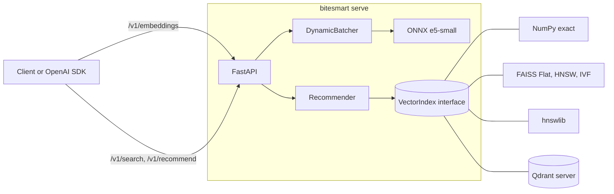

# BiteSmart RecSys

An OpenAI-compatible `/v1/embeddings` server with dynamic batching, a benchmark that compares
vector indexes (NumPy exact, FAISS Flat/HNSW/IVF, hnswlib, Qdrant) on recall@10 versus latency
and memory with metadata filters, and a product substitution recommender built on top of it.

The model is `intfloat/multilingual-e5-small` (384 dimensions). No model is trained here.

## The task

Given a grocery product the user wants to replace, return safe and sensible substitutes that
respect allergens, diets and nutrient limits. This needs three things that this project builds
and measures.

1. A fast embedding service that other tools can call with the standard OpenAI client.
2. A vector index that supports metadata filters, chosen with evidence instead of guesswork.
3. A recommender that treats allergens and diets as hard constraints, never as soft scores.

## Run the demo with one command

Requirements are Docker with Compose v2 and about 4 GB of free RAM (see the limitations).

```bash
docker compose --profile demo up --build --abort-on-container-exit --exit-code-from demo
```

This starts Qdrant and the API, waits until the model is loaded, and then runs a scripted tour.

1. Calls `/v1/embeddings` and prints cosine similarities.
2. Sends 48 concurrent single-text requests and prints the batching statistics.
3. Runs a filtered semantic search (vegan, no milk allergen).
4. Builds a substitution recommendation with hard constraints and prints the reasons.
5. Benchmarks the indexes on 5000 vectors, including the Qdrant server.

The first start downloads the model (about 470 MB) into a Docker volume. Later starts reuse it.
To keep the server running and call it yourself, use `docker compose up -d --build`, then

```bash
curl http://localhost:8000/v1/embeddings -H "Content-Type: application/json" \
  -d '{"model":"intfloat/multilingual-e5-small","input":["greek yogurt","шоколадный батончик"]}'
```

Or with the official SDK, unchanged.

```python
from openai import OpenAI

client = OpenAI(base_url="http://localhost:8000/v1", api_key="unused")
result = client.embeddings.create(model="intfloat/multilingual-e5-small", input="oat drink")
print(len(result.data[0].embedding))  # 384
```

## Local development

```bash
uv sync --extra report          # add --extra ann for hnswlib (needs a C++ compiler)
uv run pre-commit install
make check                      # ruff, mypy strict, pytest with coverage gate 70%
uv run bitesmart --help
```

| Command | What it does |
|---|---|
| `bitesmart serve --catalog data/catalog.jsonl --index faiss_hnsw` | Run the API |
| `bitesmart embed "text 1" "text 2"` | Embed locally and print the cosine matrix |
| `bitesmart bench --n 20000 --plots` | Index benchmark, writes CSV, JSON, Markdown, PNG |
| `bitesmart bench-embed` | Throughput with and without dynamic batching |
| `bitesmart recommend <product id> --vegan --forbid-allergen en:milk` | Substitutes in process |
| `bitesmart generate-catalog --n 2000` | Seeded synthetic Open Food Facts style catalog |

Settings come from `BITESMART_*` environment variables, see `src/bitesmart_recsys/settings.py`.
Use `BITESMART_EMBEDDER_BACKEND=hash` for an offline deterministic embedder (used by tests and CI).

## Architecture



More diagrams and the full reasoning are in [docs/architecture.md](docs/architecture.md).
The main decisions are summarised here.

| Decision | Why |
|---|---|
| ONNX Runtime instead of PyTorch | Smaller image, faster start. Pooling and normalisation are 10 lines with a test. |
| Dynamic batching with one asyncio worker | Many clients send one text. Merging them gives the model bigger batches. A bounded queue answers 429. |
| One `VectorIndex` interface and a neutral filter | Every backend is tested against the same reference and exact search. |
| Constraints are filters and are verified again | An approximate index must never leak an allergen. A test with a filter-ignoring index proves it. |
| Exact NumPy search as ground truth | recall@10 is computed against the exact result for the same filter. |
| Memory measured in a fresh process | In-process RSS is noisy. Qdrant is measured from its own metrics. |
| JSON logs, no `print` | Ruff rule `T20` enforces it. |

## Results

### Dynamic batching (real model, int8 variant, 32 concurrent clients, 192 requests)

| max batch | max wait ms | requests per s | p50 ms | p95 ms | mean batch |
|---|---|---|---|---|---|
| 1 (no batching) | 0 | 32.2 | 901 | 1627 | 1.0 |
| 8 | 5 | 64.1 | 470 | 558 | 8.0 |
| 32 | 10 | 87.3 | 381 | 428 | 32.0 |

Batching gives 2.7 times the throughput and less than half the p50 latency under load.
The numbers were measured on a small 3.4 GB laptop, so absolute values will differ elsewhere.

### Index comparison (20 000 vectors, 384 d, 200 queries, single thread)

Full tables for five filters are in
[docs/benchmarks/index_benchmark_n20000.md](docs/benchmarks/index_benchmark_n20000.md).
A short extract follows.

| Index | Params | recall@10 no filter | recall@10 vegan + Finland (25%) | recall@10 rare filter (1.5%) | p50 ms (no filter) | Index MB |
|---|---|---|---|---|---|---|
| NumPy exact | | 1.000 | 1.000 | 1.000 | 153 | 29 |
| FAISS Flat | | 1.000 | 1.000 | 1.000 | 7 | 29 |
| FAISS HNSW | ef 16 | 0.820 | 0.588 | 0.256 | 0.44 | 34 |
| FAISS HNSW | ef 64 | 0.987 | 0.743 | 0.380 | 0.61 | 34 |
| FAISS HNSW | ef 256 | 1.000 | 0.771 | 0.442 | 1.58 | 34 |
| FAISS IVF | nprobe 8 | 0.716 | 0.502 | 0.211 | 0.25 | 30 |
| FAISS IVF | nprobe 32 | 0.999 | 0.763 | 0.419 | 0.36 | 30 |

What this shows.

- Without a filter HNSW is the clear winner, with recall 0.987 at 0.6 ms against 153 ms for exact NumPy.
- Filters that correlate with the category (vegan, allergens) hurt approximate indexes badly.
  HNSW with an in-search id selector drops to 0.77 at the same effort, and to 0.44 for a rare filter.
- When a filter keeps few points, exact filtered search is both perfect and fast (0.23 ms for the 1.5%
  filter), because it only scores the points that pass. An index that estimates the filter
  cardinality and falls back to exact search, which is what Qdrant does with payload indexes,
  is the right design for this workload.
- Reproduce it with `uv run bitesmart bench --n 20000 --plots`. hnswlib needs the `ann` extra and
  Qdrant needs a server, so run `docker compose up -d qdrant` and pass `--qdrant-url http://localhost:6333`.

hnswlib and Qdrant server rows are produced by the Docker demo (step 5). They were not
part of the table above, because the machine that produced it could not run Docker and a C++
compiler at the same time.

## The recommender

Ported from the BiteSmart Product Substitution Recommender (thesis project). The pipeline is

1. Build an index filter from the user constraints (allergens, traces, vegan and other diets,
   same root category, country, absolute and source-relative nutrient limits).
2. Search the index with the source product vector and that filter.
3. Verify every candidate against the constraints again.
4. Score by similarity plus brand and category diversity, with an incremental diversity bonus.
5. Rerank with the category transition penalty and per-brand and per-category penalties.
6. Attach explanations and return the top N.

Not ported are the MongoDB ingestion and the CatBoost reranker, because they need the full Open
Food Facts dump and trained artifacts. The synthetic catalog has the same schema.

## Quality, tests and CI

- 107 tests, 93% coverage (gate at 70%). Fixtures, parametrization over backends and filters,
  mocks for the ONNX runtime and the Qdrant server, and a test with the official `openai` SDK.
- `ruff` for lint and format, `mypy --strict`, `pre-commit` with both.
- GitHub Actions in `.github/workflows`.
  - `ci.yml` runs lint, types, tests on Python 3.11 and 3.12, builds the Docker image and smoke tests it.
  - `docker-publish.yml` pushes the image to Docker Hub with the model baked in. It needs the
    repository secrets `DOCKERHUB_USERNAME` and `DOCKERHUB_TOKEN`.

## Known limitations

- The first start needs network access to download the model, unless the image was built with
  `--build-arg PRELOAD_MODEL=true`. The fp32 ONNX file is 470 MB and needs about 1 GB of free RAM
  to load. On small machines set `BITESMART_ONNX_FILE=onnx/model_qint8_avx512_vnni.onnx`
  (120 MB, slightly lower accuracy).
- Embedded Qdrant (`:memory:`) is exact brute force. Only the Qdrant server is a fair HNSW comparison.
- The catalog is synthetic. Real Open Food Facts data would shift recall numbers, though the
  trend for correlated filters should hold.
- Benchmarks are single threaded latency on one machine. They show relative behaviour, not
  production capacity.
- No token-id inputs, no `dimensions` other than 384, and no request authentication beyond an
  optional static bearer key.
- hnswlib has no wheels, so it is built from source (the Docker image does this). It is an optional extra.
- The `/v1/recommend` quality is judged by constraint safety tests, not by relevance labels.

## Layout

```text
src/bitesmart_recsys/
  api/         FastAPI app and OpenAI-compatible schemas
  embedding/   ONNX embedder, hash test double, dynamic batcher
  indexes/     VectorIndex interface, neutral filters, five backends
  recsys/      constraints, scoring, rerank, explanations, synthetic catalog
  bench/       dataset, runner, reports, plots, embedding load test
  cli.py       typer CLI
tests/         pytest suite
docs/          architecture and benchmark results
configs/       recommendation settings
```
