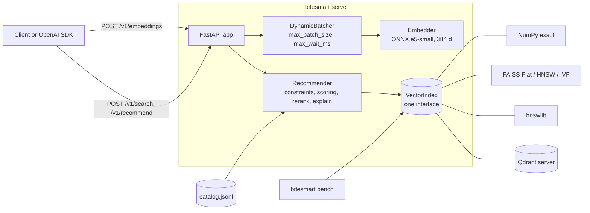
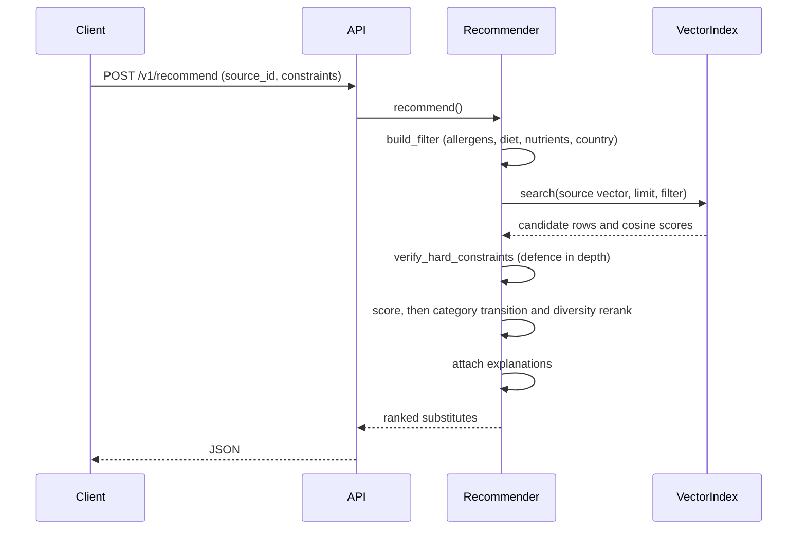

# Architecture and decisions

## Components

## Request flow for a substitution

## Decisions

### 1. ONNX Runtime instead of PyTorch for the model
`intfloat/multilingual-e5-small` ships an ONNX export. Running it with `onnxruntime` and the
`tokenizers` library removes PyTorch from the image (hundreds of MB less) and starts faster.
The price is that we implement mean pooling and L2 normalisation ourselves, which is about
ten lines and covered by a unit test.

### 2. Dynamic batching with an asyncio queue and one worker
Many clients send one text per request. A single worker collects texts until the batch is full
or `max_wait_ms` has passed, then runs one model call in a thread. This keeps the event loop
free and gives the model larger, more efficient batches. The cost is up to `max_wait_ms` of
extra latency for a lone request, which is configurable. A bounded queue answers 429 instead
of growing without limit. `bitesmart bench-embed` measures the effect.

### 3. One `VectorIndex` interface and a backend-neutral filter
Every backend implements `build`, `search(queries, k, filter)`, `set_search_params`,
`memory_bytes`. Filters are a small data structure (`Condition`, `AnyOf`, `Filter`), translated
to an id bitmap for FAISS and hnswlib, to a mask for NumPy and to `qdrant_client` models for
Qdrant. The reference evaluator `matches()` defines the semantics, so tests can compare every
backend against it and against exact search.

### 4. Hard constraints are filters, then verified again
Allergens, diets and nutrient limits are safety relevant, so they are never soft scores.
They are pushed into the index filter for speed, and every returned candidate is checked again
with `matches()`. An approximate index that mishandles a filter cannot leak an unsafe product.
A test with an index that ignores filters proves the second check works.

### 5. NumPy exact search is the ground truth
recall@10 needs a trusted reference. Exact search is run once per filter and every other
backend is scored against that filtered result, so recall is not inflated by unfiltered truth.

### 6. Memory is measured in a fresh process
RSS inside one long process is noisy (allocators keep freed pages). Each index is built in a
fresh `spawn` process and its RSS growth is reported. For a Qdrant server the number comes from
the server's own `memory_resident_bytes` metric. FAISS also reports its serialised size.

### 7. Embedded Qdrant is not used for ANN claims
`qdrant-client` in local mode is exact brute force, so it is only a functional stand-in for
tests. The comparison against HNSW uses the Qdrant server from `docker-compose.yml`.

### 8. Synthetic catalog and clustered vectors
Open Food Facts dumps are large and slow to download. A seeded generator produces products with
the same schema (taxonomy, allergens, labels, countries, nutrients). Benchmark vectors are
clustered by category, because real product embeddings are, and some filters (vegan, allergens)
correlate with the clusters, which is the hard case for filtered ANN.

### 9. Logging
All runtime logging goes through the standard `logging` module with a JSON formatter
(one object per line, `extra=` fields included). The only direct output is `typer.echo` for
results that the user asked the CLI to print. Ruff rule `T20` forbids `print` in the code base.

## What was reused from the thesis project

The recommender comes from BiteSmart Product Substitution Recommender. Ported with the same
behaviour: the hard constraint model and dietary tag sources, similarity plus brand and category
diversity scoring with the incremental bonus, per-brand and per-category penalties, the
hierarchy based category transition penalty (alpha 0.15, threshold 0.5, gamma 2) and
explanations. Not ported: MongoDB ingestion, the CatBoost reranker and the training pipelines,
because they need the full Open Food Facts dump and trained artifacts, and they are not part
of this project's scope.
